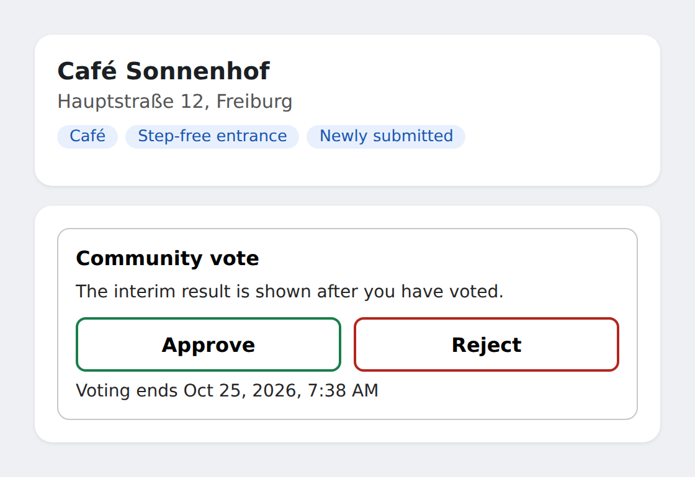
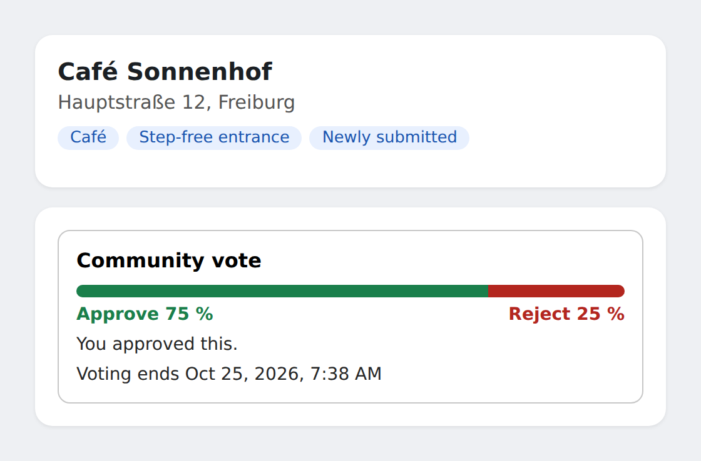
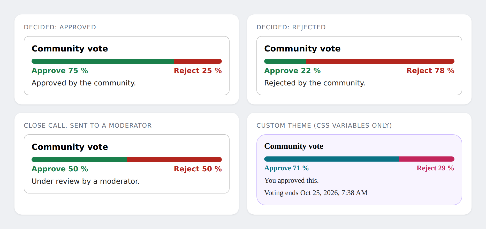
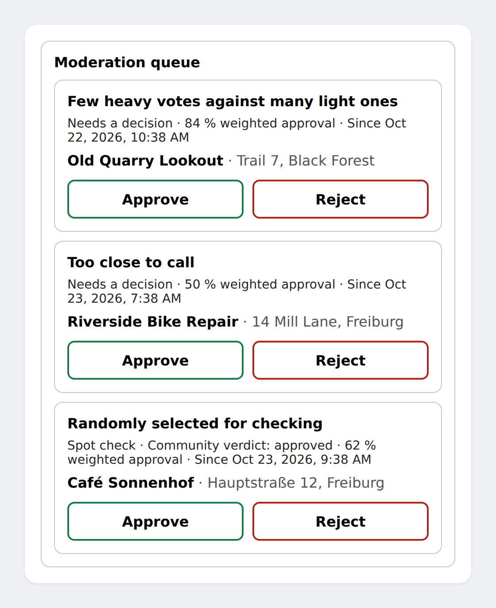

# quorum

Embeddable, service-free building block for reputation-weighted community voting
(e.g. rating points of interest). Runs inside the host website's own backend and
database. No central service.

**This is an LLM-generated project:** the code, tests and documentation were written by an LLM
(Claude). Review it and test it for your use case before relying on it.

## What it looks like

The components are plain web components (`<quorum-vote>`, `<quorum-moderation>`) that live inside
your own page and take their colours, radius and font from CSS variables.

**Before voting.** By default the interim result stays hidden until the visitor has voted, so nobody
can simply copy the leading side (`show-interim="after-vote"`; `always` and `after-close` also exist).



**After voting.** The weighted result is shown as percentages only, never head counts or who voted.



**Final states and theming.** Decided, rejected, sent to a moderator, and a custom theme set with CSS variables only.



**Moderation queue** (optional package `quorum-mod` plus the UI). Cases that need a decision come first,
spot checks after them. The host decides what a case shows.



The screenshots come from `docs/demo/demo.html`, a demo page with a fake client (no server needed).
To open it yourself: `npm run build && npm run bundle`, serve the repository root (for example
`python3 -m http.server`) and open `docs/demo/demo.html#before`, `#after`, `#states` or `#moderation`.
To regenerate the images: `python3 docs/screenshots.py` (needs `pip install playwright`).

## Packages

| Package | Purpose | Required |
| --- | --- | --- |
| `quorum-core` | Weights, evaluation, reputation updates, lifecycle, orchestration. No I/O of its own. | yes |
| `quorum-adapters` | SQL storage and schema for SQLite and Postgres. | one storage |
| `quorum-http` | Route handler on web-standard `Request`/`Response`, plus a Node adapter. | for the UI |
| `quorum-ui` | Web components `<quorum-vote>` and `<quorum-moderation>`, no dependencies. | optional |
| `quorum-mod` | Moderation queue, decisions, spot checks, audit log. | optional |
| `quorum-sim` | Simulation for tuning and stress tests (not shipped). | no |

Dependency direction: `quorum-mod -> quorum-core`. The core never depends on `mod`,
so the core runs fully without it.

## Quick start

```js
const quorum = createQuorum({ storage, hooks: { currentUser: (req) => mySession(req)?.userId ?? null } });
const api = createRouteHandler({ quorum });          // serves the four routes the UI needs
```

```html
<script type="module" src="/quorum-ui.min.js"></script>
<quorum-vote submission-id="…"></quorum-vote>
```

Two runnable examples: `npm run example:minimal` and `npm run example:moderation` (after
`npm run build && npm run bundle`).

## Documentation

- [Getting started](docs/getting-started.md): the five steps, with and without moderation.
- [How it works](docs/concepts.md): weights, windows, bands, reputation, moderation.
- [Configuration](docs/configuration.md): every parameter with its default.
- [Integration](docs/integration.md): trust boundary, storage, routes, interim result, abuse protection.
- [UI components](docs/ui.md): attributes, events, theming.

## Install

The packages are published on npm (version 0.1.0):

```sh
npm install quorum-core            # required
npm install quorum-mod             # optional: moderation
npm install quorum-adapters        # optional: SQLite and Postgres storage
npm install quorum-http quorum-ui  # optional: route handler and web components
```

`quorum-mod` and `quorum-http` need `quorum-core`. Without moderation, the vote is decided by
weight at the end of the window.

## Is it a good fit for your community?

Short version: it fits **cooperative communities with verifiable content and real accounts**,
and fits badly anonymous, commercially driven or opinion-based ones. This describes the
current default values; they are still being tuned (see `npm run sim`). Simulation figures
come from a model with stated assumptions, so trust the direction more than the exact numbers.

### Good fit

- **Niche and interest communities** with a shared goal, e.g. maps of hiking trails, climbing
  spots, accessibility, bike repair shops or local tips.
- **Content whose truth can be checked:** a place exists or not, a detail is right or wrong.
  Voters are then mostly right, and moderators can settle disputed cases.
- **Accounts that cost something:** verified e-mail, invitation or membership. Without such a
  hurdle, a handful of fake accounts is enough to push almost anything through (in the
  simulation, 10 fresh fake accounts got practically every attacker point approved).
- **Little incentive to cheat:** no money, advertising or rankings at stake.
- **At least 3 moderators**, preferably more. The conflict-of-interest rules only start at 3
  and 10 moderators, and without moderation the simulation approves about 25 % of the bad
  points (about 10 % with moderation).
- **A pace of days:** the voting window is 72 hours plus up to three extensions.
- **Sites with their own backend and database**, so the server-side checks can do their job.

### Poor fit

- **Open platforms with free anonymous sign-up and a business interest**, such as company
  listings or bought reviews. This is exactly where fake accounts and reputation farming work.
- **Matters of taste and opinion** ("best restaurant"). Reputation here comes from agreeing
  with the majority, not from being right. That rewards conformity and punishes minority views.
- **Politically or ideologically split communities.** The larger side would keep confirming
  itself.
- **Safety-critical content** such as hazards, medical or legal information. These need a
  verified source, not a herd decision with spot checks.
- **Content where a wrong approval does real harm**, e.g. statements about people. Those need
  review before publication.
- **Instant publication:** a submission is only decided once its window has ended.
- **Very small groups under roughly 10 to 15 active users.** Many submissions never reach the
  minimum number of voters and end up in moderation, and two people decide almost everything.

### Two caveats

- Large communities are no technical problem, since no parameter depends on the number of
  users. But the larger and more anonymous a community, the more profitable reputation farming
  becomes. Then the host needs strong account checks, which are not part of this module.
- Moderation is meant as occasional oversight. With heavy traffic the number of cases grows
  and the sampling rates need to be adjusted.

### Rule of thumb

It fits if all five hold: accounts cost something, answers are verifiable, there is little
incentive to cheat, at least 3 moderators are available, and days instead of seconds are fine.

## Development

```sh
npm install
npm run build   # tsc -b across all packages
npm test        # vitest, resolves workspace packages from source
```

All tunable parameters live in `packages/core/src/config.ts`. Defaults are
provisional and meant to be tuned via simulation.

## License

[MPL-2.0](./LICENSE). In short: you can use quorum in any project, including commercial,
closed-source and paid products, without opening your own code. If you change quorum's own files
and distribute the result (for example a fork), those changed files must stay under MPL-2.0 and
be available as source.
