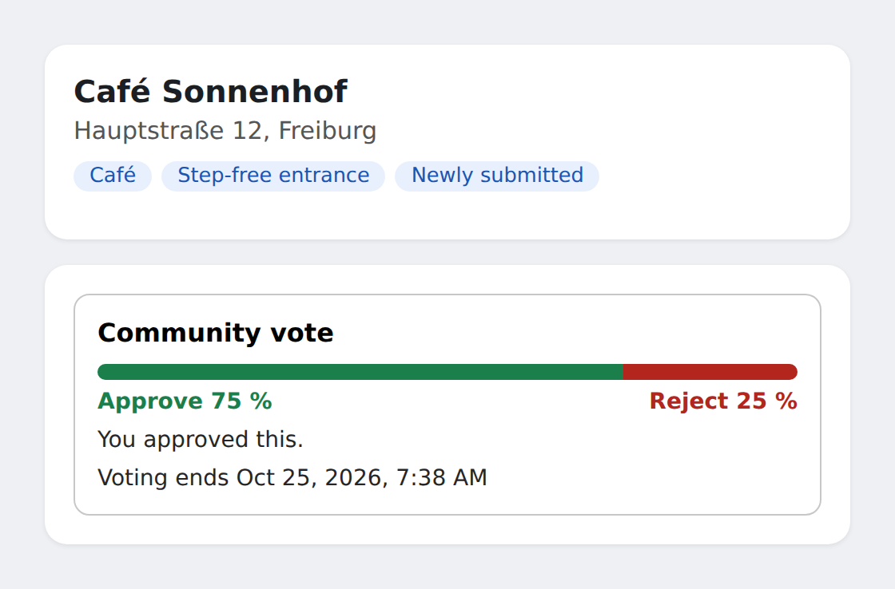
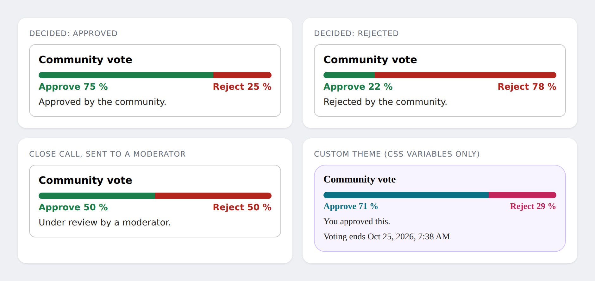
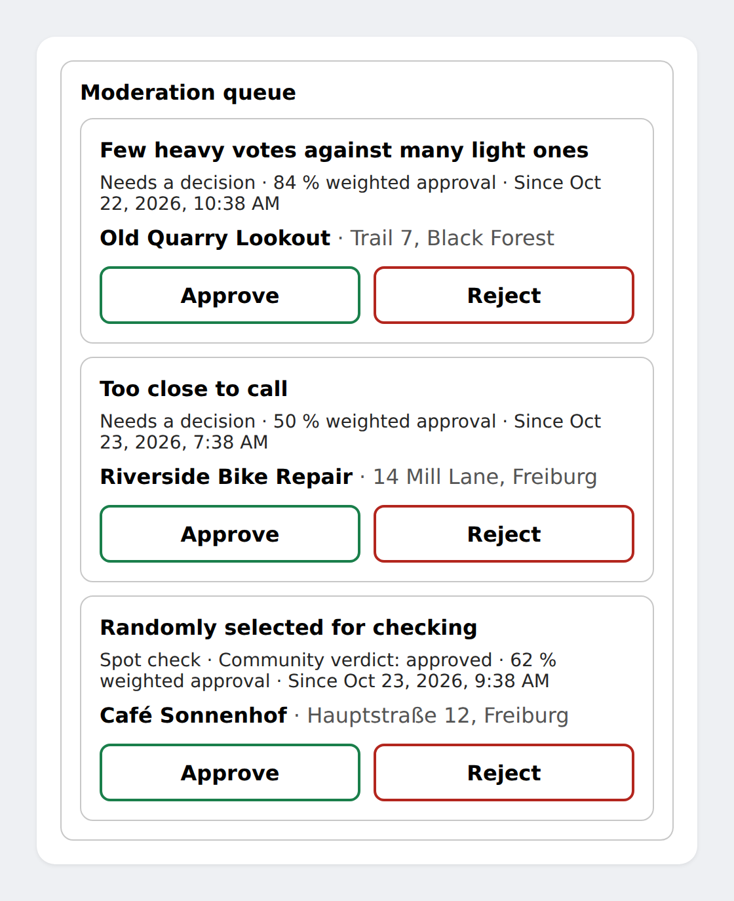
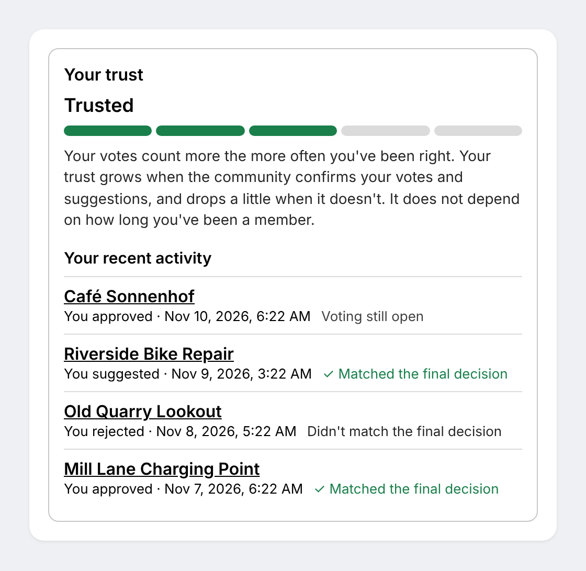

# UI components

Three framework-free web components in `quorum-ui`, no runtime dependencies (about 20 KB minified).
They live in Shadow DOM, follow the page's light or dark mode, and are styled with CSS variables.



## Using them

As a single file (no build step on your side):

```html
<script type="module" src="/quorum-ui.min.js"></script>
```

Build it with `npm run bundle`; it registers all three elements on load. As a package:

```js
import { register } from "quorum-ui";
register();                                  // or register({ vote: "my-vote", moderation: "my-mod", profile: "my-profile" })
```

By default the components call the routes of [`quorum-http`](integration.md#routes) at
`/api/quorum` with your session cookie. Change that per element with `api="/other/base"`, or for the
page with `configureQuorum`:

```js
import { configureQuorum, createHttpClient } from "quorum-ui";
configureQuorum({
  client: createHttpClient({ baseUrl: "/api/quorum", headers: () => ({ "x-csrf": token() }) }),
  interim: "after-vote",                     // default interim visibility
  labels: { title: "Is this place correct?" },
});
```

You can also hand any object with `getSubmission`, `vote`, `getQueue`, `decide`, `getProfile` to an element as its
`client` property, for example to use your own API.

## `<quorum-vote>`



| Attribute | Meaning |
| --- | --- |
| `submission-id` | Which submission. Required. |
| `show-interim` | `after-vote` (default), `always` or `after-close`. A display setting only, see [integration.md](integration.md#showing-the-interim-result). |
| `lang` | `de` or anything else for English. Falls back to the nearest `lang` on the page. |
| `api` | Base URL of the routes for this element. |

Shows the weighted result as percentages only, the vote buttons while voting is possible, and the
final state (decided, under review, waiting for the result).

- **Events:** `quorum-loaded` (`detail.view`), `quorum-voted` (`detail.choice`), `quorum-error` (`detail.error`).
- **Methods:** `refresh()` reloads from the server.

## `<quorum-moderation>`



Attributes `lang` and `api` as above. Lists the cases the current moderator may take, cases that
need a decision first. Set `subjectRenderer` to show what a case is about; the module cannot know,
because your payload is yours:

```js
el.subjectRenderer = (c) => `Submission ${c.id}`;      // plain strings are shown as text
// or return a DOM node for richer content
```

Events: `quorum-loaded` (`detail.cases`), `quorum-decided` (`detail.id`, `detail.verdict`), `quorum-error`.

## `<quorum-profile>`



```html
<quorum-profile limit="10" lang="de"></quorum-profile>
```

Shows the logged-in member **their own** trust and history. Put it on a profile or account page.

- **Trust level** as one of five steps (New, Contributor, Trusted, Experienced, Top level), never as
  the raw reputation number. The step comes from the vote weight relative to a new member's weight:
  at most 1×, below 2×, below 5×, below the cap, at the cap. With the defaults that is reputation
  up to 0, 1–7, 8–16, 17–31 and 32+. Without a cap the top step is never reached.
- **A short explanation** of how trust works (the text from [end-users.md](end-users.md#trust-level-profile-page)).
- **Recent activity:** the member's votes and suggestions, newest first, each with "Matched the
  final decision", "Didn't match the final decision", "Voting still open" or "Being checked by a
  moderator". A mismatch is shown in a neutral colour on purpose: being in the minority is not a mistake.
- **Not logged in:** a short "Log in to see your trust level" instead of an error.

| Attribute | Meaning |
| --- | --- |
| `limit` | How many history entries (1 to 50, default 10). |
| `hide-explanation` | Leave out the explanation, e.g. if your page already has one. |
| `hide-recent` | Show the trust level only. |
| `lang`, `api` | As above. |

Each entry is named after `payload.name` or `payload.title` of the submission, otherwise its
`subjectId`. Change that, and link entries to your map, with two properties:

```js
el.subjectLabel = (a) => myPlaces.get(a.subjectId)?.title ?? "A place";
el.subjectHref = (a) => `/map/${a.subjectId}`;         // return null for no link
```

The step names are in `labels.levels` and can be replaced like any other text. If you want your own
steps, `trustLevel()` and `LEVEL_COUNT` are exported, or build your own display from the data:
`GET /me` returns `reputation`, `weight`, `maxWeight`, `baseWeight` and `recent`.

**Privacy.** The route only ever returns the logged-in member's own data. Never show another
member's level next to their votes: it would undo the anonymity of voting.

**Storage.** The history needs `listVotesByVoter` and `listSubmissionsByAuthor` on your storage.
The SQL adapters have both. A custom storage without them still works: `recent` is then `null` and
the component shows the trust level only.

Events: `quorum-loaded` (`detail.profile`), `quorum-error` (`detail.error`). Method: `refresh()`.

## Theming

Set variables on the element or any ancestor:

```css
quorum-vote { --quorum-yes: #0b7285; --quorum-no: #c2255c; --quorum-radius: 18px; }
```

| Variable | Default | For |
| --- | --- | --- |
| `--quorum-yes`, `--quorum-no` | green, red (lighter in dark mode) | Bar, percentages, button outlines |
| `--quorum-fg`, `--quorum-bg` | page text colour, transparent | Text and box background |
| `--quorum-border`, `--quorum-track` | a faint mix of the text colour | Box border, empty bar |
| `--quorum-radius`, `--quorum-button-radius`, `--quorum-padding` | 10px, 8px, 14px | Shapes and spacing |
| `--quorum-font`, `--quorum-title-size` | system font, 1rem | Typography |
| `--quorum-bar-height` | 10px | Bar |
| `--quorum-focus` | `Highlight` | Keyboard focus ring |
| `--quorum-level` | `--quorum-yes` | Filled steps of the trust level |

For deeper changes use `::part(root | title | bar | bar-yes | bar-no | legend | status | button | button-approve | button-reject | error | case)`,
and for the profile `::part(level | meter | explanation | recent-title | recent | item | outcome | outcome-matched | outcome-not-matched | outcome-pending)`.

## Texts and languages

German and English are built in. Override single texts with `configureQuorum({ labels })` or the
element's `labels` property. Texts from the server are always shown as text, never as HTML.

The components explain their own states, but not why voting works this way. Put a short explanation
next to them, see [end-users.md](end-users.md).

## Accessibility

The bar has a text alternative, buttons are at least 44 px high and have a visible focus ring, status
changes are announced politely, and reduced-motion settings are respected.
